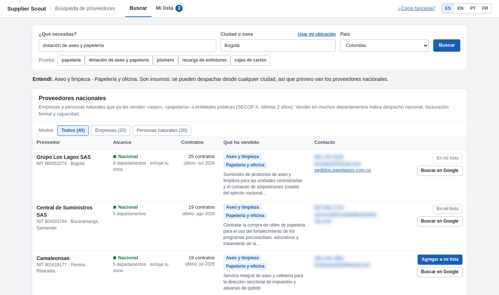
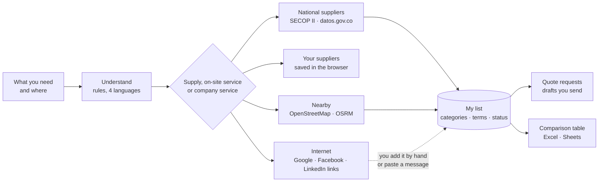

<div align="center">

# Supplier Scout

**Find suppliers the way purchasing does: several options for every need, not just the shop around the corner.**<br>
National companies that already sell to the state · your known suppliers and their terms · nearby businesses on the map · ready-made searches on Google, Facebook and LinkedIn.

[](https://github.com/Dsergio909/supplier-scout/actions/workflows/ci.yml)


[**Live demo**](https://dsergio909.github.io/supplier-scout/) · [How it works](docs/how-it-works.md) · [Cómo funciona (español)](docs/como-funciona.md) · [Resumen en español](#resumen-en-español) · [Playbook: suppliers that are not online](docs/offline-playbook.md) · [Countries and languages](docs/countries.md)



</div>

## The problem

A map search answers "who is near me?". Purchasing asks a different question: "who can supply this, on what terms?". For many needs the best answer is not nearby:

1. **Supplies come from national companies.** Stationery, cleaning supplies, uniforms or toner are usually bought from distributors that deliver nationwide, invoice electronically and give 30 to 90 days of credit or quarterly payment. Their warehouse is in another city, so a map never shows them.
2. **One supplier often covers several needs.** The distributor that sends stationery may also send cleaning and coffee supplies, which means one supplier to register, one contract and one invoice.
3. **Purchasing needs several options.** Three quotes is the usual rule, and options come from different places: the state's own suppliers, the ones you already know, the shop around the corner, a Facebook page, a referral.
4. **The best small suppliers are often not on the web.** Workshops and family businesses sell by phone or WhatsApp and appear on community maps, not in search results.

The full walkthrough is in **[How it works](docs/how-it-works.md)** ([español](docs/como-funciona.md)).

## What it does

Type what you need in your own words (*papelería*, *dotación de aseo y papelería*, *recarga de extintores*, *plomero*) and the place. The app says what it understood and whether the need is a supply that can be shipped, an on-site service or a service that companies provide, and orders four layers accordingly:

1. **National suppliers (Colombia, SECOP II).** Companies **and individuals** (personas naturales: in Latin America many suppliers are, and they are often cheaper) that sold that need to public entities in the last two years, from the government's open data. One row per supplier: in how many departments it sells (selling in three or more means it delivers nationally), how many contracts, the last one, **a real contract as an example** of what it sold, and its public phone, email and website. A request with several needs (*aseo y papelería*) puts first the suppliers that cover all of them, and a filter shows companies or individuals. People hired by the state as quasi-staff (*prestación de servicios profesionales y de apoyo a la gestión*), public utilities and joint ventures are left out. An individual's ID number is never shown or saved, and a note reminds the buyer that their contact details are personal data and what to ask before buying (RUT, the *documento soporte* if they do not invoice, social security for services).
2. **Your suppliers for this.** The suppliers you saved for those categories, with their commercial terms: credit days, payment (cash, monthly, quarterly), delivery coverage and electronic invoicing.
3. **Nearby.** Real businesses from OpenStreetMap on a map, with driving time, phone and opening hours when the map has them, and the same search in Google Maps. On-site services (a plumber, a locksmith) show this layer first; for supplies it is one click away.
4. **Search the internet.** Ready-made searches for wholesalers and nationwide distributors on Google, company pages on LinkedIn and business pages on Facebook, plus a local search. Plain links: nothing is scraped.

**My list** keeps the suppliers to contact from any layer, or added by hand (paste a WhatsApp message or a business card and the form fills itself). Each supplier can cover several categories, and the list shows progress towards three quotes per category. *Request quotes* drafts one message per supplier for WhatsApp or email, optionally asking for the documents to register the supplier, and *Download table* exports the comparison table (cuadro comparativo) for Excel or Sheets.

The command line and the optional Claude agent add what a desk analysis needs: the real cost of an order (packs, minimum order, tax, shipping, currency, payment term), a fair rating, trust from referrals, duplicate detection and connectors for other registries.

## Finding suppliers that are not online

The full guide is in the [playbook](docs/offline-playbook.md).

| Channel | How Supplier Scout helps |
|---|---|
| Public procurement (Colombia) | The national layer of the web app: companies that already sell that need to public entities, by NIT, with the departments they sell in and a real contract as an example. The CLI also reads SECOP, any OCDS publisher and any Socrata portal |
| Community maps | The nearby layer: a live OpenStreetMap search, reporting how many businesses have no website, plus a one-click Google Maps search for the ones OpenStreetMap does not have |
| Facebook, Google and LinkedIn | Ready-made searches (pages, wholesalers, nationwide distributors, companies). They open in a new tab; nothing is copied from those sites |
| Referrals, fairs, business cards, WhatsApp | Paste the text into the supplier form and a rule-based parser fills name, phone, email, credit days, coverage and categories. The CLI imports fair and chamber-of-commerce lists (CSV) and counts independent referrals |
| Verification | Links to RUES and DIAN (and each country's tax portal), tax-ID check digits, and the public contract history of national suppliers |

## Countries and languages

Built in Colombia, meant for Latin America, usable anywhere. The full table is in [docs/countries.md](docs/countries.md).

- **23 country profiles + a generic one:** the 17 Spanish-speaking countries of Latin America from Mexico to Argentina (Cuba uses the generic profile), plus Puerto Rico, Brazil, Spain, Portugal, France and the US. Each one knows its currency, its sales tax name and default rate (IVA, IGV, ITBIS, ITBMS, ISV, IVU, TVA), its tax ID, its phone habits and where formal suppliers are listed (procurement portal, business registry, data-protection law).
- **Tax-ID check digits in 13 countries**, including Brazil's alphanumeric CNPJ (from July 2026). Where no public check-digit rule exists (Mexico's RFC, Venezuela's RIF, most of Central America), the ID is checked for format and the app says "format only" instead of "valid".
- **How suppliers actually write:** Argentina's "15" mobiles, Mexico's old "044", RD$, quetzales, colones, guaraníes, "+ IGV", "com impostos", "HT", an *arroba* (12.5 kg in Colombia, 15 kg in Brazil), *tlapalería* or *ferragens*, and addresses by landmark ("100 varas al sur").
- **Four languages:** the web app, the explanation of every ranking, the quote and referral requests (which name the local tax: "¿incluye IGV?") and the agent. The app follows the browser's language.
- **Sample data** for Bogotá, Mexico City and São Paulo.

## How the ranking works (command line and agent)

| Factor | What it measures | When data is missing |
|---|---|---|
| Price | Quoted unit price with tax relative to the cheapest option; with a quantity, the total cost of an order (packs, minimum, tax, shipping, currency, payment term) | Neutral + "ask for a quote" |
| Rating | Bayesian blend: a neutral prior worth 5 reviews, online reviews (capped at 100), team reviews ×3 | Neutral |
| Distance | Inside your radius; suppliers that deliver keep a floor | Neutral |
| Trust | Verification level + independent referrals (self and same-group referrals ignored, mutual ones count half) | Lowest level |
| Speed | Lead time; a hard warning if it misses your deadline | Neutral |

Weights are presets (balanced, cheapest, most reliable, nearest, urgent) or sliders.

## Design decisions

- **Missing data is neutral, never zero.** This is what lets an offline supplier with no reviews and no quote yet compete with a web shop, while still showing what to ask for.
- **Precision over recall for duplicates.** Same tax ID, phone, email or corporate domain merges automatically; a similar name alone always goes to a person. Two different valid tax IDs are never merged, even with a shared phone.
- **The agent cannot invent suppliers.** The output file contains only suppliers a tool returned. Whatever the model writes is used for the summary and the drafts, not as data.
- **One logic, three front ends.** `src/core` is plain JavaScript with no dependencies. The browser demo, the CLI and the agent run the same code, and the tests cover it.
- **Country-agnostic by configuration.** A country is one profile: currency, default sales tax, tax-ID rules, phone habits and local weights. Adding one touches no other file. Local details are respected: a "libra" in a Colombian market is 500 g, and a regional unit always asks for confirmation.
- **Honest validation.** A tax ID is "valid" only when a check digit proves it; otherwise the app says "format only". A label shared by several countries ("RUC" is used in five) switches country only on a verified check digit, never on a guess.
- **No AI where rules are enough.** Card and WhatsApp parsing is rule-based, runs offline and is predictable. The model is used only where it adds something: planning a search from a plain-language request.

## The AI agent

`agent/` uses the Claude API (official `@anthropic-ai/sdk`, model `claude-opus-5-5` by default) with seven read-only tools: `find_coordinates`, `search_my_database`, `search_map`, `search_public_registry` (Colombia), `search_google_places` (only if you set a key), `rank_candidates` and `draft_messages`.

- **It only reads and drafts.** There is no tool to send messages, write files or browse arbitrary pages. You review and send.
- **Data minimisation.** Phone numbers and emails never go to the model; WhatsApp links for the drafts are filled in locally. Suppliers who refused consent for their personal data are ranked locally but never described to the model.
- **Cost control.** At most 12 steps per run, effort `medium`, prompt caching, and token usage printed at the end.
- **Safety.** Tool results are treated as data, not instructions (a business name on a map could contain text meant to manipulate the model). If a safety classifier declines a request, the API's server-side fallback retries on its recommended model (`fallbacks: "default"`).
- **`--dry-run`** runs the same tools in a fixed order without AI or a key, to try it or compare.
- **Language:** `--lang es|en|pt|fr`; by default, the language of the country (`--country BR` answers in Portuguese).

## Security

| Risk | Mitigation |
|---|---|
| AI invents suppliers, prices or reviews | Candidates come only from tool results; the loop is tested with a scripted model that tries to invent one |
| Prompt injection through third-party data (names, notes) | Tools are read-only; no send or write tools; the system prompt marks tool output as data; a person sends every message |
| Personal data sent to the AI provider | Tool results strip phones and emails (tested) |
| API keys leaking | Keys only in environment variables (`.env` is git-ignored, `.env.example` is empty); the Places key goes in a header, never the URL (tested) |
| Query injection (Overpass QL, SoQL) | User text is reduced to letters and digits before building map queries; SoQL string literals are escaped (tested) |
| Malicious import file (XSS, `javascript:` links, huge files) | One sanitising gate for all external data (also applied to what the browser saved, since storage is shared by every page on the same GitHub Pages domain); http(s) links only; 2 MB limit; the page renders with `textContent` only |
| Huge or hostile inputs (availability) | Capture text capped at 5,000 characters and tested against regex backtracking; imports capped at 2,000 suppliers; duplicate search and ranking tested to stay fast at those limits; connector responses capped at 5 MB while streaming |
| Spreadsheet formula injection in the CSV export | Cells starting with `=`, `+`, `-`, `@` are exported as text (tested) |
| Web app | Strict CSP: scripts and styles come from the site itself (no web fonts: the system's own font); `connect-src` allows only Nominatim, Overpass, the OSRM routing server and datos.gov.co, used only when you press *Search*, and `img-src` only OpenStreetMap's tiles (tested). Marker colours are set through the CSSOM because inline style attributes are blocked. No cookies or trackers. Map and registry results go through the same sanitising gate as any import; the saved list is checked the same way when read back from storage |
| Individuals in public procurement data | Individuals are suppliers too, but their tax ID is their national ID number: it is used only to look up their public supplier contact, kept out of the rendered page, the saved list (a derived key instead) and the export, and never sent to Google (searched by name and city). Only their own registered contact is read, never the legal-representative fields. A note in the page cites Colombia's data-protection law (Ley 1581 of 2012): use their contact only to request a quote. Contracts that are personal-service work for the state, agreements with non-profits, leases and minors' ID documents are excluded in the query. The live check publishes no SECOP responses and blurs phones and emails in its screenshots (all tested) |
| Personal data of sole traders (Colombia: Law 1581 of 2012; LGPD in Brazil and similar laws across the region) | Consent checkbox on capture that names the selected country's law, warning in the ranking when consent was refused, never sent to the AI agent when refused, data stays in the browser unless exported. The OCDS connector imports the business, never the contact person's name (tested) |
| Leaking real data from this public repo | All data is fictional: `.example` domains, phones in unassigned ranges (Colombia `999`, Mexico `55 0000`, Brazil `(11) 0000`, or ranges reserved for fiction), tax IDs generated with a correct check digit. Tests enforce it |
| CI supply chain | Read-only permissions, no persisted credentials, every GitHub Action pinned to a commit SHA (tested; Dependabot updates the pins), `npm ci --ignore-scripts`, one runtime dependency (the official SDK, used only by the agent), Dependabot for security updates |
| Script injection through map data | Trusted Types enforced by the CSP (`require-trusted-types-for 'script'`), no HTML-string sinks anywhere in the web app (tested), every value rendered with `textContent` |
| Abuse of free services and location privacy | Nominatim and OSRM calls queued to at most one per second across searches (tested); the browser location is rounded to about 100 m before it is sent; nothing about the buyer is sent to datos.gov.co except the words searched |
| Wrong but real results | Map tags checked against the OpenStreetMap wiki; name words that caught unrelated businesses (kindergartens, banks, universities) narrowed, with tests |
| Terms of the data sources | datos.gov.co (SECOP II): open government data, credited under every table, a short gap between requests and at most four per search; OSM and Nominatim: attribution, one geocoding call per search (a second one a second later only when the place is not in the chosen country), no search-as-you-type, a 10 km radius cap and the button disabled while a search runs (the CLI also sends an identifying User-Agent); OSM tiles: attribution on the map, a Referer on every tile request (the page otherwise sends none), only the tiles in view; OSRM demo server: one table request per search, at most 100 places, non-commercial use, credited; Overpass: one retry after 3 s when busy, no unverified mirrors (some serve stale data silently); Google Maps: only an official search link, nothing is copied and no Google data is shown on the OSM map (against Google's terms); Google Places (CLI, your own key): records are flagged for refresh or deletion per Google's terms |

## Architecture



## Project structure

```
src/core/          shared logic, no dependencies (browser + Node)
  services.js        what the buyer typed -> trades, categories, map tags and name words (rules, ES/EN/PT/FR)
  channels.js        supply, on-site service or company service -> which layers first; Google, Facebook and LinkedIn searches
  secop.js           national suppliers from SECOP II: companies and individuals, staff contracts out, merge by tax ID, contact details
  osm.js             OpenStreetMap query and parsing, place disambiguation and search radius, Google Maps link
  shortlist.js       the saved list: sources, categories, commercial terms, statuses, three quotes per need, CSV
  countries.js       23 country profiles: currency, tax, tax-ID check digits, phone habits, registries
  capture.js         business card / flyer / WhatsApp text -> draft supplier
  quotes.js · reviews.js · trust.js · dedupe.js · score.js   order cost, ratings, referrals, duplicates, ranking (CLI and agent)
  csv.js · schema.js import/export and the sanitising gate
  messages.js · outreach.js   explanations and quote / referral drafts (ES / EN / PT / FR)
src/connectors/    OpenStreetMap, Socrata/SECOP, OCDS, Google Places, Nominatim (Node)
cli/scout.js       connectors, CSV import, merge and rank from the terminal
agent/             Claude agent: tools, loop, system prompt, CLI
demo/              the web app (GitHub Pages): app.js, live.js (the only file that uses the network),
                   map.js (OSM tiles + markers, no library), i18n.js (ES/EN/PT/FR texts)
tools/             the live check run in GitHub Actions (services, searches and the page in a browser)
tests/             198 tests
docs/              how it works (ES/EN), screenshots, the offline playbook and the country coverage table
```

## Run it

Requires Node 22+.

```bash
npm test                 # the whole suite, no network and no API key needed
```

**Web app:** open [the live demo](https://dsergio909.github.io/supplier-scout/), or serve the repository locally (for example `python3 -m http.server`) and open `/demo/`.

**Connectors (no AI):** each command writes a JSON file that `merge`, `rank` and the agent read.

```bash
npm install
npm run scout -- osm --category packaging --lat 4.6782 --lng -74.1411 --radius 3000 --out data/map.json
npm run scout -- registry --preset secop-co --describe          # show the dataset's columns and how they were mapped
npm run scout -- registry --preset secop-co --q "carton corrugado" --city Bogota --out data/secop.json
npm run scout -- registry --domain https://data.example.gov --dataset abcd-1234 --country XX --q "..."   # any Socrata portal
npm run scout -- ocds --file releases.json --country PY --q "carton" --out data/ocds.json   # any OCDS publisher (or --url https://...)
npm run scout -- csv --file exhibitors.csv --country CO --out data/fair.json
npm run scout -- merge data/map.json data/secop.json data/fair.json --out data/all.json
npm run scout -- rank --db data/all.json --category packaging --qty 500 --lat 4.6782 --lng -74.1411 --radius 12 --days 7
```

**Agent:**

```bash
cp .env.example .env     # put your ANTHROPIC_API_KEY in .env (never in code)
node --env-file=.env agent/cli.js "Necesito 500 cajas de cartón corrugado cerca de Fontibón, Bogotá, en 7 días" \
     --db data/all.json --out data/result.json

# Without AI or a key: the same tools in a fixed order
npm run agent -- --dry-run --db data/all.json --category packaging --qty 500 --lat 4.6782 --lng -74.1411 --days 7
```

`data/` is git-ignored so your real supplier lists never end up in the repository.

## What is tested, and what is not

Being explicit, because this matters more than the feature list:

- **Automated (198 tests in CI):** all core logic; how typed requests are understood in four languages and which layers come first; the SECOP queries (companies and individuals, staff contracts and minors excluded, an individual's ID never serialised, the last two years, escaped input, the contract-description filter), how companies are merged across departments and needs, the check digit of a NIT, phone numbers with their area code; every country profile and tax-ID check digit; cards and WhatsApp messages written the way suppliers write across the region; the connectors against fixtures shaped like each API; the CLI end to end; the agent loop against a scripted stand-in for the Claude API; the saved list and its CSV; the live map search with simulated OpenStreetMap and OSRM responses; the web app's CSP and rendering guards.
- **Checked against the live services (November 2026):** a manual GitHub Actions workflow (`live-check.yml`) runs the app's own code against the real datos.gov.co, Nominatim, Overpass and OSRM, and uses the page in Chromium. Last run (3 November 2026): **10 national searches** (stationery, cleaning and stationery, extinguisher refills, private security, security, cardboard boxes, toner, uniforms, cleaning products, plumber). In 9 of them the companies listed are the right kind; for *plumber* they are hardware and building-maintenance suppliers, because the state rarely hires plumbing on its own. **All 40 companies checked by tax ID** have contracts under that NIT and are in the SECOP supplier registry, and **21 of 21 map businesses** checked exist on OpenStreetMap with the same name. In the browser, searches took 3-9 s on desktop and on a phone, with no console or security-policy error and nothing wider than the screen. The first run is what shaped this version: single words brought the wrong companies (*vigilancia* brought epidemiological surveillance, *empaques* brought laundries), individuals appeared with their ID number, old landlines had no area code, and the national table overflowed on a phone. All of that is fixed and covered by tests. **With individuals (second round, same day):** 12 national searches; individuals are 15-20 of the 40 suppliers listed in most of them (2 for private security, 0 for cardboard boxes), none of them a quasi-staff contract, and all 58 suppliers checked (companies and individuals) have contracts under that tax ID and are in the registry. Individuals with national reach exist: one extinguisher service sells in 17 departments. No ID number of an individual appears on screen (checked in the browser) or in the published results. The map alone found nothing for 6 of 12 searches (cardboard boxes in Fontibón, extinguisher refills in Cali, a locksmith in San Gil), which is why it is one layer of four.
- **Not run against live services:** the CLI's OCDS and Google Places connectors and the Claude agent; their request formats follow each service's documentation.
- **Known limits:** the national layer exists only for Colombia; SECOP shows who sells to the state, which is a strong signal of capacity and formality but not a full market (many good suppliers never sell to the state); the example contract is one of many and the public contact details are what the company registered; map results depend on what volunteers have mapped, so trades such as plumbers or fire-extinguisher refills often return few businesses, which is why every search also opens in Google Maps and Facebook; GitHub Pages cannot send security headers, so the CSP is a `<meta>` tag; driving times ignore traffic.

## Roadmap

- **Supplier self-registration:** a QR code at a fair booth linking to a Google Form, imported through the same CSV path (an Apps Script adapter, as in [Supplier Radar](https://github.com/Dsergio909/supplier-radar)).
- **Photo of a business card:** OCR (a local model such as Qwen, or Claude vision) feeding the same rule-based parser.
- **WhatsApp inbox to review queue** with an n8n flow.
- Run the agent with a local model for zero API cost.
- Landed cost
- An agent tool for OCDS publishers; check digits for Mexico's RFC homoclave and Venezuela's RIF.

## About

Built by **Sergio García**, an International Business graduate (diploma pending) based in Bogotá who likes turning repetitive work into automated systems. I don't come from engineering: I learn by building, using generative AI as a pair programmer. Supplier Scout is an independent project built with Claude Code; the design choices (neutral scoring for missing data, human review, drafts instead of automatic messages) come from what I saw of how purchasing actually works.

Companion project: [Supplier Radar](https://github.com/Dsergio909/supplier-radar) keeps track of the suppliers you already have; Supplier Scout finds new ones.

[Portfolio](https://dsergio909.github.io/) · [LinkedIn](https://linkedin.com/in/sergio-david-garcia-celis-836b8a250) · [dsergio909@gmail.com](mailto:dsergio909@gmail.com)

---

---

## Resumen en español

**Supplier Scout** sirve para encontrar proveedores como se hace en compras: varias opciones para cada necesidad, no solo el local de la esquina.

- **Escribes lo que necesitas y dónde** (*papelería*, *dotación de aseo y papelería*, *recarga de extintores*, *plomero*) y la app dice qué entendió y si es un insumo que se despacha, un servicio en sitio o un servicio de empresa. Con eso ordena cuatro capas.
- **Proveedores nacionales (Colombia):** empresas **y personas naturales** que ya les venden eso a entidades públicas, según los datos abiertos de SECOP II. Por cada proveedor: en cuántos departamentos vende (tres o más indica despacho nacional), cuántos contratos, el último, **un contrato real como ejemplo** de lo que vendió y su teléfono, correo y web públicos. Si pides varias cosas (*aseo y papelería*), primero van los que cubren todo, y un filtro muestra empresas o personas naturales. Quedan fuera los contratistas que el Estado contrata casi como empleados (*apoyo a la gestión*), las empresas de servicios públicos y los consorcios. La cédula de una persona nunca se muestra ni se guarda, y una nota recuerda que sus datos son personales y qué pedir antes de comprarle (RUT, documento soporte si no factura, seguridad social en servicios).
- **Tus proveedores para esto,** con sus condiciones: días de crédito, forma de pago (contado, mensual, trimestral), cobertura del despacho y factura electrónica.
- **Cerca:** negocios reales de OpenStreetMap en un mapa, con tiempo en carro, y la misma búsqueda en Google Maps. Para un plomero o un cerrajero esta capa va primero.
- **Buscar en internet:** búsquedas listas de mayoristas y distribuidores con despacho nacional en Google, empresas en LinkedIn y páginas en Facebook. Son enlaces: no se copian datos.
- **Mi lista:** guardas proveedores de cualquier capa o a mano (pegas un mensaje de WhatsApp o una tarjeta y el formulario se llena solo). Cada uno puede cubrir varias categorías, ves el avance hacia tres cotizaciones por categoría, pides cotizaciones por WhatsApp o correo (con los documentos para inscribir al proveedor, si quieres) y descargas el cuadro comparativo para Excel o Sheets.
- **Probado con datos reales** (noviembre de 2026) en GitHub Actions: 10 búsquedas nacionales, las 40 empresas revisadas existen con su NIT en SECOP, los 21 negocios del mapa revisados existen en OpenStreetMap, y la página funcionó en computador y celular sin errores. Detalle en [What is tested](#what-is-tested-and-what-is-not).

En cuatro idiomas (español, inglés, portugués y francés). [Ver la demo](https://dsergio909.github.io/supplier-scout/) · [Cómo funciona](docs/como-funciona.md) · [Guía para encontrar proveedores fuera de internet](docs/offline-playbook.md).

## License

[MIT](LICENSE)
